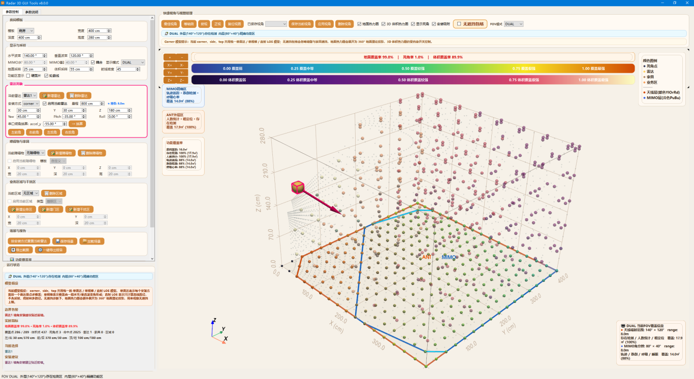
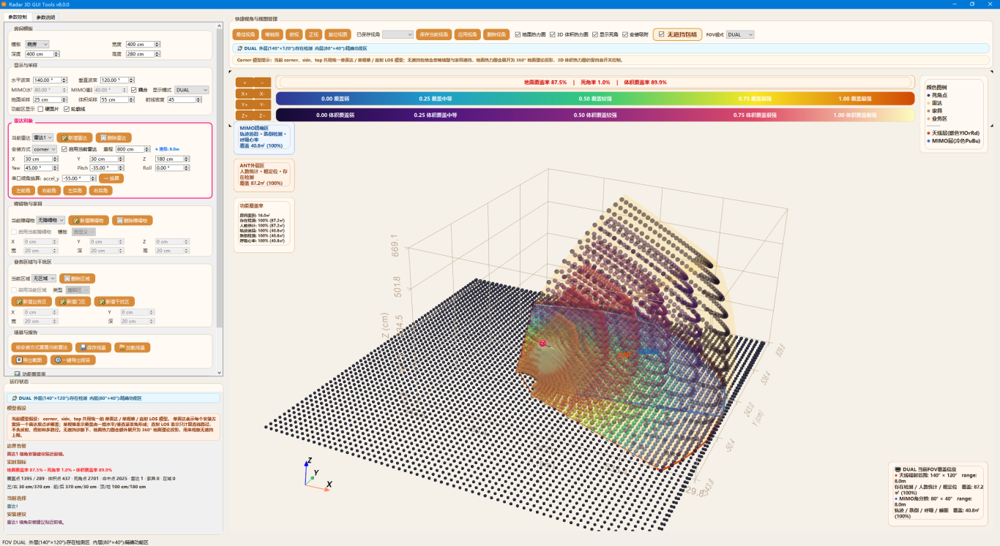
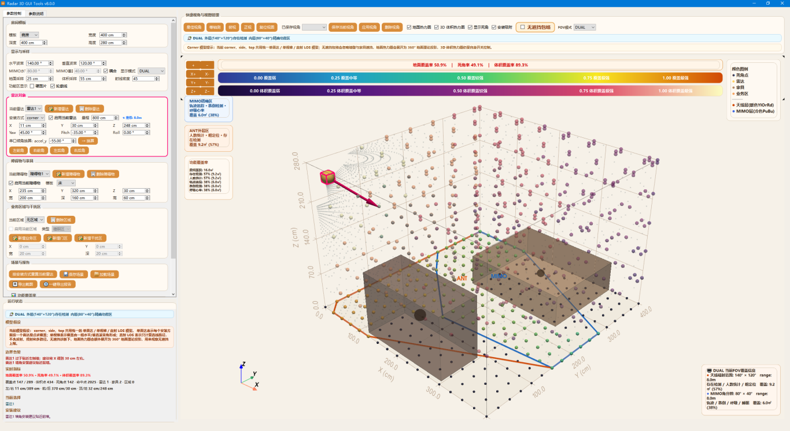

> 🏠 [返回主页](https://github.com/hhtbing) | **中文** / [English](./README_en.md)

# TI 毫米波雷达开发平台


## 📋 项目概述

基于 TI 毫米波雷达芯片的完整开发平台和工具链。该项目作为早期雷达开发阶段的技术积累，包含了从硬件配置、固件开发到数据处理的完整工具链体系。

**项目类型：** 嵌入式开发平台 + 工具链  
**技术领域：** 毫米波雷达、嵌入式系统、信号处理  
**状态：** 归档（技术参考）

## 🖼️ 雷达 3D 部署与覆盖分析

基于同一雷达技术积累，开发了面向安装规划的 Python 桌面 3D 分析工具，支持房间与家具建模、多雷达布置、视场范围、遮挡、盲区和覆盖热力图分析。

### 3D 覆盖分析总览



左侧参数面板可设置房间尺寸、雷达安装位置、阵列参数、障碍物和功能区，右侧按房间坐标渲染 3D 空间点云和覆盖体。顶部实时显示覆盖率 99.0%、死角率 1.0%、体积覆盖率 80.9%，图例区分盲区、弱点、合规、满足区和多雷达覆盖区。

### 3D 体积热力图



同一场景切换到体积热力图后，房间网格按覆盖强度从绿色过渡到红色，覆盖率 87.5%、死角率 1.0%、体积覆盖率 89.9%，可直接定位不同高度和距离上的覆盖薄弱区域。

### 房间建模与遮挡验证



房间内放置两个家具体块作为遮挡物后，覆盖率降到 50.9%、死角率升到 49.1%，右侧按 Z 轴分层显示各层死角率为 1.1%、27.4%、51.3% 和 59.0%，用于评估真实家具布局对安装方案的影响。

---

## 🏗️ 系统架构

```
┌─────────────────────────────────────────────────────────────┐
│                   TI 雷达开发平台                            │
└─────────────────────────────────────────────────────────────┘
                              │
        ┌─────────────────────┼─────────────────────┐
        │                     │                     │
        ▼                     ▼                     ▼
┌───────────────┐    ┌───────────────┐    ┌───────────────┐
│ 雷达配置工具   │    │ 固件开发工具   │    │ 数据处理工具   │
└───────────────┘    └───────────────┘    └───────────────┘
        │                     │                     │
        ▼                     ▼                     ▼
   参数配置             固件烧录              信号处理
   性能调优             版本管理              数据可视化
   场景适配             调试工具              算法验证
```

---

## 🛠️ 核心工具链

### 1. 雷达配置工具集
- **配置生成器** - 自动生成雷达参数配置文件
- **性能调优工具** - 参数优化和性能测试
- **场景适配工具** - 针对不同应用场景的参数调整
- **配置验证器** - 参数合法性检查和冲突检测

### 2. 固件开发工具集
- **固件烧录工具** - 支持批量烧录和版本管理
- **串口调试工具** - 实时日志监控和命令交互
- **固件打包工具** - 自动化构建和发布流程
- **版本管理系统** - 固件版本追踪和回退机制

### 3. 数据处理工具集
- **数据采集工具** - 雷达原始数据捕获和存储
- **信号处理引擎** - FFT、点云处理、目标检测
- **数据可视化工具** - 实时波形显示和轨迹追踪
- **算法验证平台** - 离线数据回放和算法测试

---

## 🎯 技术亮点

### 完整的开发工具链
- 覆盖从硬件配置到数据处理的完整开发流程
- 自动化程度高，降低开发门槛
- 模块化设计，工具可独立使用

### 多场景适配能力
- 支持人体检测、手势识别、生命体征监测等多种应用场景
- 快速参数配置和调优工具
- 场景模板库，快速复用成熟方案

### 数据处理流水线
- 实时数据采集和处理
- 完整的信号处理算法库
- 可视化调试和验证工具

### 工程化实践
- 自动化构建和部署
- 版本管理和回退机制
- 完善的日志和调试支持

---

## 🛠️ 技术栈

**硬件平台：**
- TI 毫米波雷达芯片
- DSP 信号处理单元
- 串口通信接口

**开发工具：**
- TI SDK 和工具链
- Python（工具开发）
- C/C++（固件开发）

**数据处理：**
- NumPy、SciPy（信号处理）
- Matplotlib（数据可视化）
- 自研算法库

---

## 📊 技术演进

该项目为后续的 **AWRL6844 雷达网关系统** 奠定了技术基础，包括：
- 雷达配置方法论
- 固件开发流程
- 数据处理算法
- 工具链设计思想

---

## 🔗 相关项目

- [AWRL6844 雷达网关](../radar-gateway/README.md) - 下一代雷达系统

---

*本项目展示了毫米波雷达开发的完整工具链体系，作为技术积累和参考保留。*
