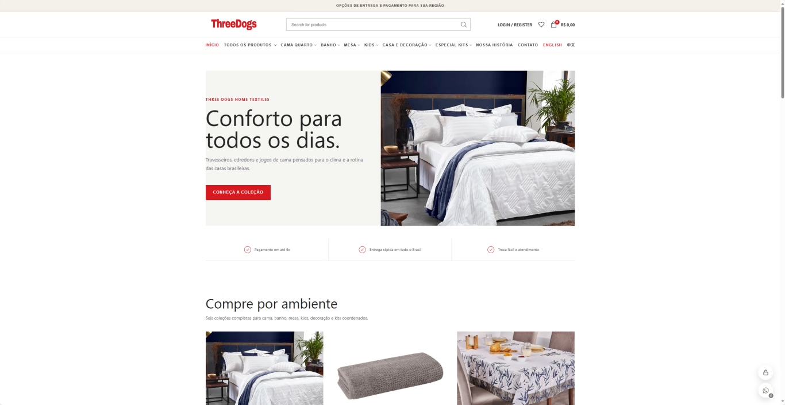
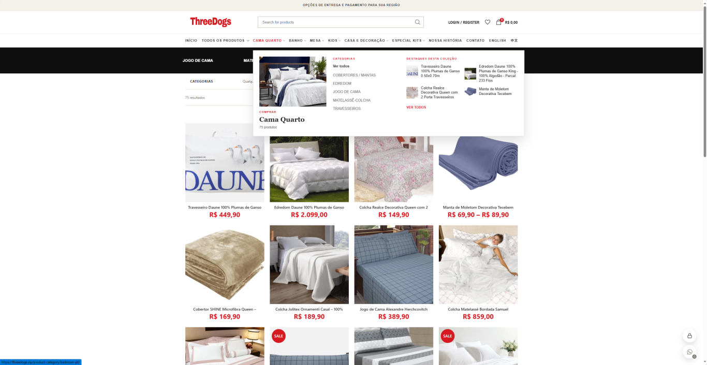
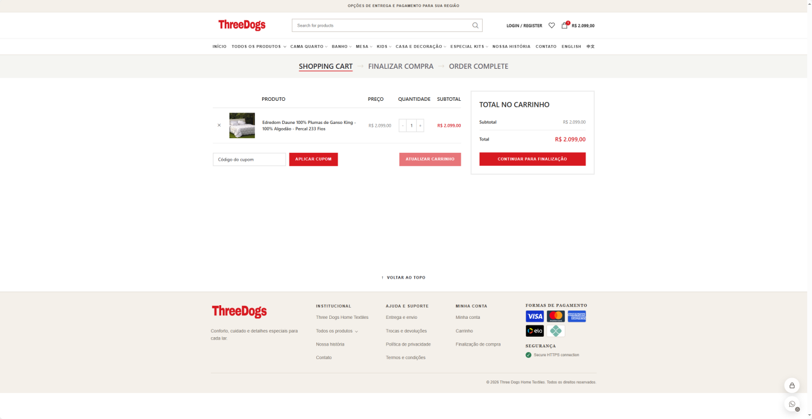
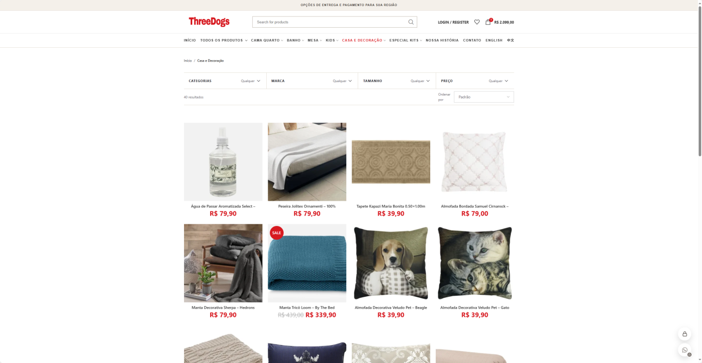

> 🏠 [返回主页](https://github.com/hhtbing) | **中文** / [English](./README_en.md)

# Three Dogs — 多语言 WooCommerce 家居电商独立站

## 📋 项目概览

面向巴西家居纺织品 B2C 零售的多语言 WooCommerce 独立站，支持葡萄牙语、英语和中文浏览。项目覆盖首页品牌展示、商品分类 Mega Menu、搜索筛选、商品详情、购物车、优惠券和结算前流程。

**项目类型：** 电商独立站  
**时间：** 2026 年  
**本人职责：** 站点结构、分类与多语言配置、主题前台样式与交互联调  
**技术栈：** WordPress、WooCommerce、Elementor、Woodmart、PHP、HTML5、CSS、JavaScript、jQuery

## 🖼️ 案例截图

### 首页品牌与品类入口

首页顶部包含区域与支付选项、搜索框、登录/注册、购物车和主导航，导航栏提供 ENGLISH 与中文切换。首屏展示品牌床品大图和 “Conforto para todos os dias.” 文案，下方是分期付款、巴西全境配送、换货和客服三项承诺，以及按卧室、浴室、餐桌等场景购买的入口。

### 商品分类 Mega Menu

卧室床品分类页展开 Mega Menu，左侧是分类入口，中间是精选商品和价格，右侧是关联推荐。主体区显示 75 个商品结果，商品卡包含图片、名称、价格和 SALE 标签。

### 购物车与结算前流程

购物车页顶部是三步结算进度条，主体包含商品行、数量调整、优惠券输入、更新购物车按钮和订单总价，底部页脚展示支付方式与 Secure HTTPS 标识。

### 家居装饰分类筛选

家居装饰分类页包含面包屑、分类/品牌/尺寸/价格四组筛选和排序下拉，显示 40 个结果，商品覆盖香氛、床品、地毯和抱枕等品类。

## ⚡ 核心功能

- 多语言浏览：葡萄牙语、英语和中文切换
- 商品分类 Mega Menu 和多级导航
- 搜索、分类/品牌/尺寸/价格筛选、排序和促销标签
- 商品详情、加购、购物车数量与优惠券
- 结算前流程，以及配送、支付、隐私和售后政策入口
- 响应式布局和移动端显示检查

## 🎯 适用需求

- WordPress/WooCommerce 电商独立站搭建和前台改造
- 多语言商品浏览、分类导航和筛选
- 购物车、优惠券和结算前流程联调
- 需要展示电商前台完整链路的客户

## 🔒 使用边界

图片是公开店铺前台截图，再次对外发送前仍需检查是否包含真实订单、客户数据、后台地址或内部配置。不得公开后台账号、支付凭据、订单数据和客户信息；不得把前台展示扩展为未经验证的销量或转化率结论。
