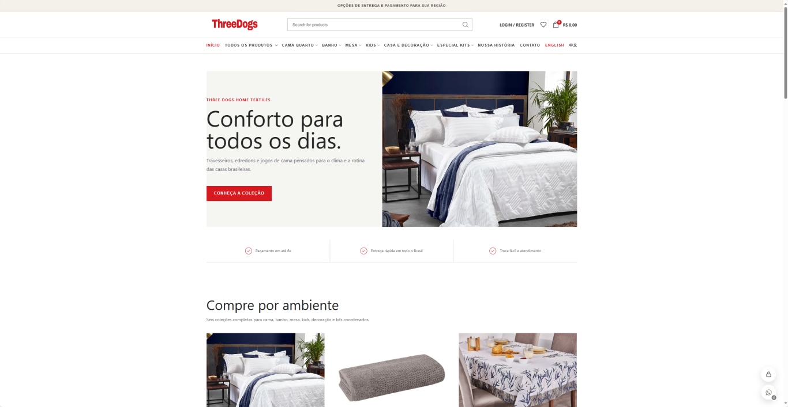
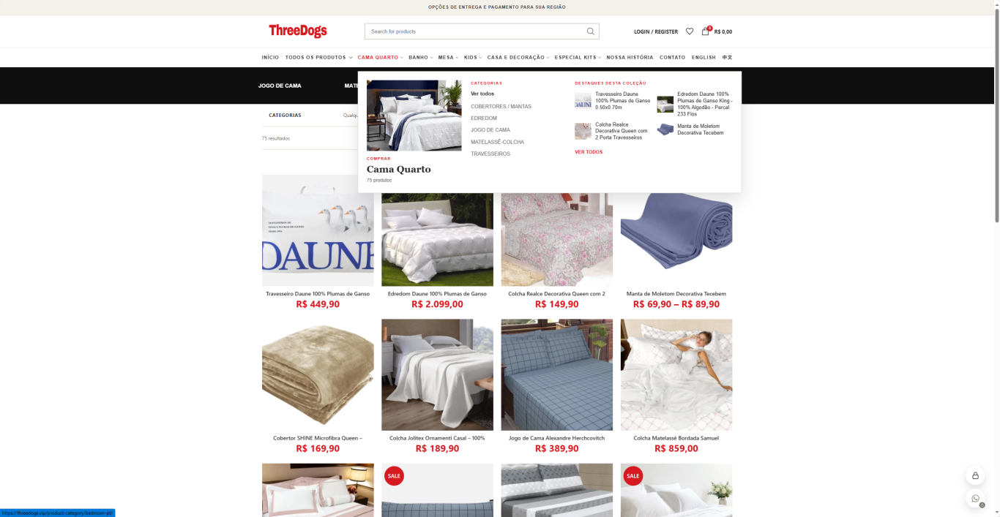
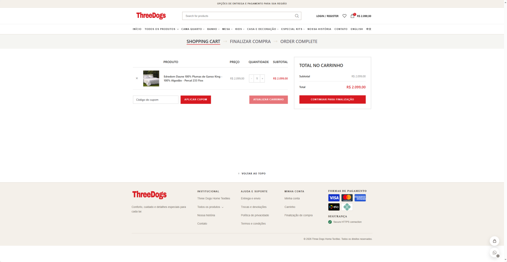
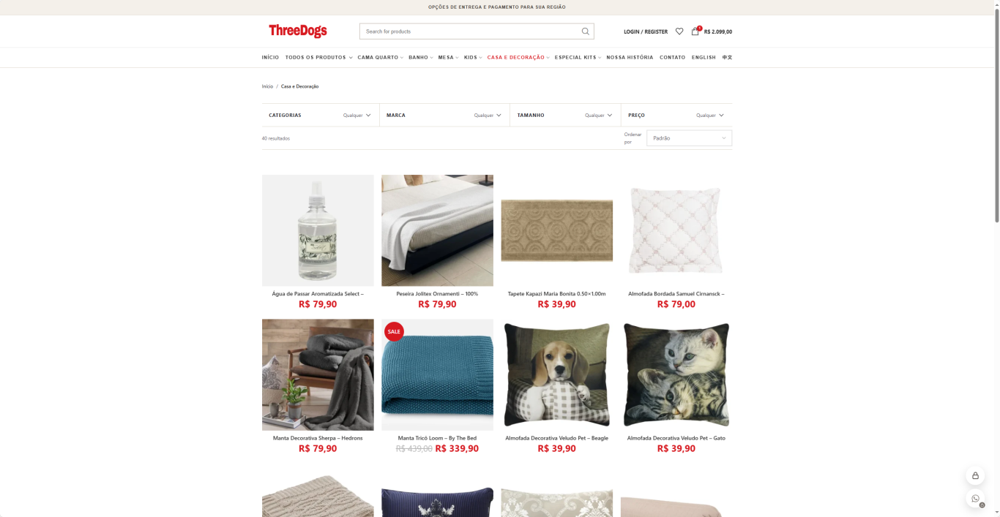

> 🏠 [Back to Homepage](https://github.com/hhtbing) | [中文](./README.md) / **English**

# Three Dogs — Multilingual WooCommerce Home Textile Store

## 📋 Project Overview

A multilingual WooCommerce storefront for a Brazilian home textile B2C retailer, supporting Portuguese, English and Chinese browsing. The project covers the homepage, category Mega Menu, search and filtering, product details, cart, coupons and the pre-checkout flow.

**Project Type:** E-commerce storefront  
**Timeline:** 2026  
**My Responsibilities:** Site structure, category and multilingual configuration, theme styling and interaction integration  
**Tech Stack:** WordPress, WooCommerce, Elementor, Woodmart, PHP, HTML5, CSS, JavaScript, jQuery

## 🖼️ Case Screenshots

### Homepage Brand and Category Entry

The header includes region and payment options, search, login/register, cart and the main navigation with ENGLISH and Chinese switching. The hero shows the brand textile image and "Conforto para todos os dias." copy, followed by installment, nationwide delivery, exchange and support commitments, plus shopping entries organized by bedroom, bathroom and dining room.

### Category Mega Menu

The bedroom textile category expands a Mega Menu with category entries on the left, featured products and prices in the middle, and related recommendations on the right. The main area shows 75 product results with images, names, prices and SALE labels.

### Cart and Pre-Checkout Flow

The cart page shows a three-step checkout progress bar, product rows with quantity controls, a coupon field, a cart update button and the order total, with payment methods and a Secure HTTPS badge in the footer.

### Home Decor Category Filtering

The home decor category page includes breadcrumbs, category/brand/size/price filters and a sorting dropdown, showing 40 results across fragrance, bedding, rugs and cushions.

## ⚡ Core Features

- Multilingual browsing in Portuguese, English and Chinese
- Category Mega Menu and multi-level navigation
- Search, category/brand/size/price filtering, sorting and promo labels
- Product details, add-to-cart, cart quantity and coupons
- Pre-checkout flow with shipping, payment, privacy and after-sales entries
- Responsive layout and mobile display checks

## 🎯 Suitable For

- WordPress/WooCommerce storefront builds and front-end redesigns
- Multilingual product browsing, category navigation and filtering
- Cart, coupon and pre-checkout flow integration
- Clients who need to see the full storefront journey

## 🔒 Usage Boundaries

The screenshots are public storefront captures. Before sending them externally, check for real orders, customer data, backend addresses or internal configuration. Do not expose backend accounts, payment credentials, order data or customer information, and do not extend the storefront presentation into unverified sales or conversion claims.
